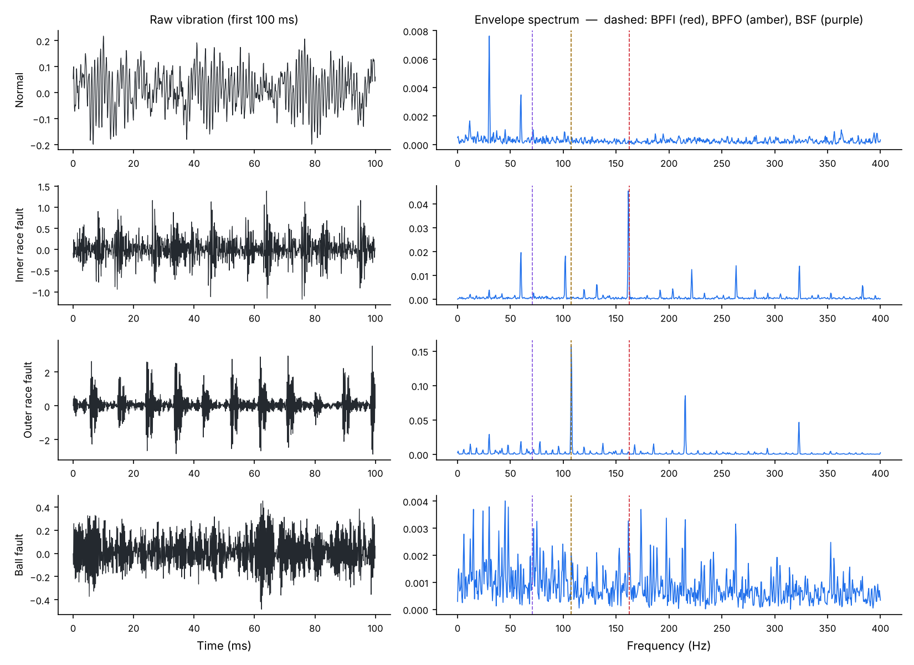

# Bearing Fault Detection from Vibration Signals

Diagnosing rolling-bearing faults (inner race, outer race, ball) from raw accelerometer data, combining signal-processing features grounded in bearing physics with machine-learning classifiers and a physics-informed neural network.

[](https://github.com/alaaeddinethr/Predictive-Maintenance-Dashboard-Bearing-Fault-Detection/actions/workflows/ci.yml)


> Extension of a project that placed 3rd at the MTI 2025 hackathon (physics-informed neural networks for bearing degradation).

## Why it matters

Bearings are one of the most common failure points in rotating machinery: motors, pumps, gearboxes, railway axles. A defect on a ring or a ball produces a small impact every time a ball rolls over it. Those impacts repeat at frequencies fixed by the bearing geometry, so a fault can be detected and located from vibration long before the machine breaks.

## What the signals look like



The envelope spectrum (right) is where the physics shows. The inner-race fault peaks exactly at **BPFI = 162 Hz** and its harmonics, the outer-race fault at **BPFO = 107 Hz**, both predicted from the bearing geometry before looking at any data. Ball faults are the hardest case: their signature is weak and buried in noise, which matches what the bearing-diagnostics literature reports for this dataset.

## Results

Data: CWRU bearing dataset, drive-end accelerometer at 12 kHz, 20 recordings, 4 classes (normal, inner race, outer race, ball), 2,048-sample windows. Each window is described by **52 features**: 18 time-domain (RMS, kurtosis, crest factor...), 20 frequency-domain (band powers, energy around BPFI/BPFO/BSF/FTF) and 14 envelope features.

**Evaluation on an unseen operating condition.** The model is trained on three motor loads and tested on the fourth, which it has never seen (`src/models/evaluate_by_load.py`):

| Model | 0 HP | 1 HP | 2 HP | 3 HP | Mean |
|---|---|---|---|---|---|
| XGBoost | 99.9 % | 100 % | 100 % | 99.5 % | **99.8 %** |
| Random Forest | 100 % | 100 % | 100 % | 100 % | **100 %** |

**A note on honest evaluation.** A random train/test split of overlapping windows also gives 100 %, but that number is meaningless: neighbouring windows from the same recording end up on both sides. Holding out a whole operating condition is the stricter test. Even so, CWRU is a clean laboratory benchmark and near-perfect scores on it are common (Smith & Randall, 2015). The real challenge is generalising to other machines, noisier sensors and fault sizes not seen in training; see next steps.

## Physics-informed neural network

The PINN learns an attention weight for each of the 52 features. Its loss adds a physics term that forces the network, for each fault class, to attend more to the features computed at that fault's theoretical frequency than to the others (energy at BPFI for an inner-race fault, at BPFO for an outer-race fault, at BSF for a ball fault):

```
L_total   = L_cross-entropy + λ · L_physics
L_physics = mean( max(0, attention_other_faults − attention_own_fault + 0.1) )      λ = 0.1
```

The network therefore cannot reach a correct answer for a physically wrong reason, and its attention weights can be read as an explanation. Fault frequencies come from the bearing geometry (SKF 6205, 9 balls, shaft at 1,797 rpm):

| Frequency | Formula | Value |
|---|---|---|
| BPFI (inner race) | `(N/2)(1 + d/D·cos α)·fr` | 162.2 Hz |
| BPFO (outer race) | `(N/2)(1 − d/D·cos α)·fr` | 107.4 Hz |
| BSF (ball spin) | `(D/2d)(1 − (d/D)²cos²α)·fr` | 70.6 Hz |
| FTF (cage) | `(1/2)(1 − d/D·cos α)·fr` | 11.9 Hz |

## Project structure

```
src/
├── data/
│   ├── download_data.py        # download CWRU files, build windowed dataset
│   └── preprocessing.py        # band-pass filter, normalisation, windowing
├── features/
│   ├── feature_extraction.py   # 52 time, frequency and envelope features
│   └── plot_signals.py         # envelope-spectrum figure above
├── models/
│   ├── train.py                # XGBoost, Random Forest, PINN
│   ├── pinn.py                 # physics-informed network and loss
│   ├── evaluate.py             # metrics and plots
│   └── evaluate_by_load.py     # leave-one-load-out evaluation
└── dashboard/app.py            # Streamlit diagnosis dashboard
tests/test_features.py          # 17 unit tests
```

## Run it

```bash
pip install -r requirements.txt
python src/data/download_data.py --process      # ~80 MB from Case Western Reserve University
python src/models/evaluate_by_load.py           # results table above
python src/models/train.py --model all          # train XGBoost, Random Forest and PINN
streamlit run src/dashboard/app.py              # interactive dashboard
pytest tests
```

## Next steps

- **Cross-fault-size test**: train on 0.007" defects, test on 0.014" and 0.021", closer to real wear progression.
- **Cross-dataset test**: train on CWRU, test on the Paderborn or IMS datasets with different machines.
- **Degradation, not just classification**: estimate remaining useful life from run-to-failure data, as in my [turbofan RUL project](https://github.com/alaaeddinethr/turbofan-rul-prognostics).

## References

- Smith, W. A., Randall, R. B. (2015). Rolling element bearing diagnostics using the Case Western Reserve University data: a benchmark study. *Mechanical Systems and Signal Processing*, 64–65.
- Raissi, M., Perdikaris, P., Karniadakis, G. E. (2019). Physics-informed neural networks. *Journal of Computational Physics*, 378.
- Case Western Reserve University Bearing Data Center: https://engineering.case.edu/bearingdatacenter

---

Alaa Eddine Tahir, engineering student at Arts et Métiers · [LinkedIn](https://linkedin.com/in/alaaeddine-tahir)
